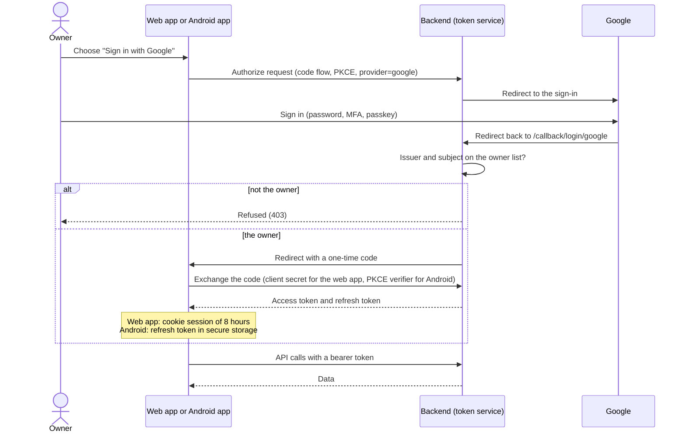

# Sign-in

KbcTracker has one user and no passwords. The backend signs you in through an external OpenID Connect provider
(Google first) and issues its own tokens; only the account listed in `Authentication:Owners` gets through
([ADR-0009](../adr/0009-authenticate-the-owner-with-external-openid-connect-providers.md), proposed). To set it up,
see [Set up sign-in](../how-to/set-up-sign-in.md).

## The parts

- **The backend's token service** (OpenIddict) serves the authorize, token and revoke endpoints for two clients: `web`
  (confidential) and `mobile` (public, with PKCE). It sends you to the provider, checks the returned issuer and
  subject against the owner list, and issues tokens of about 10 minutes with rotating refresh tokens.
- **The web app** keeps a cookie session of 8 hours. Its calls to the backend carry the `web` client's own token,
  because a user token cannot be refreshed inside a live Blazor Server connection.
- **The Android app** keeps the refresh token in secure storage and calls the backend with the access token.

## The flow

The browser reaches the backend as `http://localhost:5080/` and the Android emulator reaches it there through
`adb reverse`, because Google accepts a plain-HTTP redirect for `localhost` only.

## Signing out

Signing out ends the session in the app and revokes the refresh token at the backend. The web app's cookie is not
stored on a server, so a copy of it stays valid until its 8 hours end.
